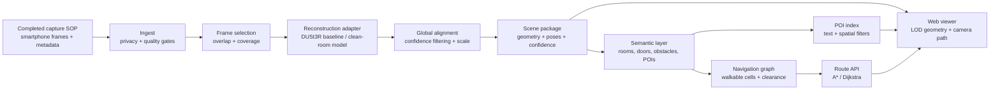
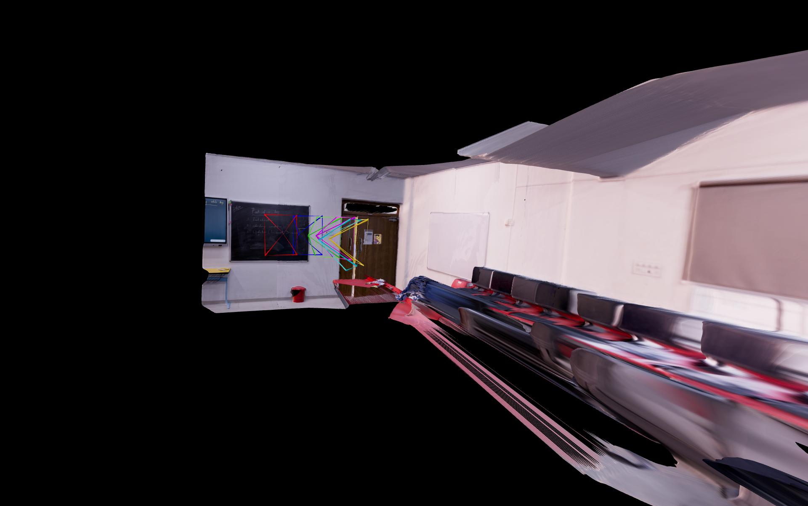
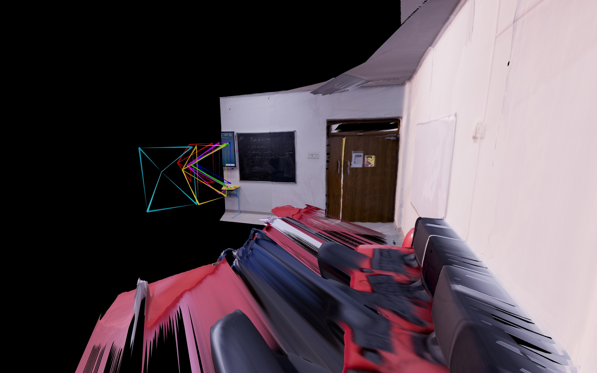

# makeify — An Indoor Spatial Engine

> **From a phone walkthrough to a place you can explore, search, and navigate.**

makeify is an end-to-end spatial computing project for **Namma Space by Techfest, IIT Bombay**. It transforms ordinary smartphone captures of an indoor environment into an interactive 3D digital twin: a scene that can be explored in a browser, searched through meaningful points of interest, and used to calculate safe, obstacle-aware routes.

This repository is the project’s technical home. It brings together the research direction, system architecture, capture assumptions, evaluation plan, provenance records, and licensing boundaries in one readable place. The capture SOP has already been completed once; the purpose of this repository is to make the next stages repeatable, explainable, and defensible.

> **License boundary:** DUSt3R code and checkpoints are subject to CC BY-NC-SA 4.0 and the licenses of their datasets and base checkpoints. This repository does not relicense those materials for commercial use.
---

## The idea in one sentence

**makeify builds a navigable digital twin from a phone-based indoor capture, then turns that twin into a useful spatial interface rather than leaving it as a beautiful but inert point cloud.**

That distinction matters. A reconstruction is only the beginning. The finished experience must answer questions such as:

- Where is the reception desk?
- Can I move from this room to that room without passing through a wall?
- What does the space look like from another viewpoint?
- Which path is available when an obstacle blocks the shortest route?

The system therefore treats geometry, semantics, search, navigation, and presentation as one connected product.

## What the competition asks for

The official Namma Space brief describes an intelligent spatial engine that converts standard smartphone captures of indoor spaces into interactive 3D digital twins. The competition is organized around reconstruction and roaming, POI search and navigation, and a final on-site capture and live demonstration. [1]

For Round 1, teams are asked to submit a technical abstract, a proof-of-concept web viewer, a code repository, and a 3–5 minute demo showing free roaming. Later stages add POI tagging, search indexing, obstacle-aware desktop navigation, and a new venue captured on the IIT Bombay campus. [1]

The public competition page requires open-source tools to be credited and licensed correctly. It also asks that supplementary links or drive materials be organized inside one master PDF. The public page does **not** state a formal page count, word count, font specification, or file-size limit for the technical abstract or master PDF. That absence is recorded explicitly in [`docs/problem-statement.md`](docs/problem-statement.md) rather than replaced with an invented rule.

---

## What exists in this repository today

DUSt3R was implemented as the reconstruction core in [`demo.py`](demo.py). It accepts multiple images of one indoor scene, performs pairwise inference, aligns the resulting pointmaps, filters low-confidence geometry, and exports a colored GLB reconstruction through Gradio. The implementation was good enough to prove the pipeline and produce the example outputs in this repository, but not good enough to claim reliable, competition-ready geometry for every scene.

That limitation is part of the research result, not something to hide. The current code demonstrates image-to-3D reconstruction, while the full NammaSpace target still requires a more reliable scene package, semantic POIs, a searchable index, a walkable occupancy graph, obstacle-aware routing, and a browser experience built around those products. The next engineering step is to improve capture coverage, alignment, confidence filtering, and scene-scale handling rather than pretending the first DUSt3R run solved the whole problem.

## Why DUSt3R is a strong research starting point

Traditional multi-view stereo pipelines often depend on camera calibration and reliable camera poses before they can triangulate a scene. DUSt3R takes a different route. It treats pairwise reconstruction as pointmap regression and is designed to work with image collections that do not arrive with known calibration or viewpoint poses. When more than two images are available, its global alignment stage places pairwise predictions into a common reference frame. [2] [3]

For makeify, that makes DUSt3R a compelling **research baseline**:

1. A smartphone capture can be treated as a collection of ordinary images rather than a carefully calibrated survey.
2. The reconstruction stage can produce 3D points, depth, matches, and camera information that downstream systems can consume.
3. Confidence values provide a useful signal for deciding which parts of the scene should be trusted, reviewed, or treated as uncertain.
4. The model can sit behind a narrow adapter, allowing the rest of the system to remain stable if the reconstruction engine changes.

The important engineering decision is not to make DUSt3R the identity of the entire project. It should be a replaceable component inside a larger spatial pipeline.

### The research position

The project’s hypothesis is simple:

> **A practical indoor digital twin is created by combining robust reconstruction with explicit uncertainty, lightweight semantics, and conservative navigation—not by optimizing visual geometry in isolation.**

That leads to a deliberate sequence. First, obtain a coherent scene. Then filter and align it. Then derive geometry that a browser can load. Then add the semantic layer that gives objects and spaces meaning. Finally, build the walkable graph and the user-facing viewer.

A dense point cloud may look impressive in a screenshot. A useful digital twin must also know where it is uncertain, what can be searched, and where a person can safely move.

---

## The system, from capture to experience



The source diagram is available at [`architecture/system.mmd`](architecture/system.mmd).

## Visual evidence

These are the project’s current example outputs, generated from a small multi-image capture. They show the central technical promise of NammaSpace: even before the semantic and navigation layers are complete, a compact set of images can become a navigable 3D scene with visible camera geometry. The remaining work is to make that scene more coherent, searchable, and safe to route through.



*Figure 1 — Current reconstruction output from the makeify prototype.*



*Figure 2 — Alternate view of the current reconstruction output, including estimated camera frustums.*

### 1. Capture

The completed SOP is the foundation of the whole project. It should produce overlapping views, gradual motion, room entrances from useful angles, and enough coverage of floors, ceilings, corners, corridors, and difficult surfaces to support reconstruction. Sensitive material, faces, screens, and unnecessary personal data should be excluded or redacted at capture time.

Each capture session should carry a manifest containing a session identifier, frame paths, timestamps, device information, route order, operator, consent or retention status, and a scene boundary. The manifest is not paperwork added after the fact; it is what allows a result to be repeated and explained.

### 2. Ingest and quality gates

The ingest stage normalizes orientation, removes duplicates, scores blur and exposure, checks motion, and measures whether adjacent views overlap sufficiently. Original files remain in restricted staging. Inference uses a documented derivative set, with hashes retained for reproducibility.

### 3. Reconstruction

The reconstruction adapter accepts images and options and returns a stable scene representation:

```text
reconstruct(images, options) -> ReconstructionResult

ReconstructionResult:
  points: float32[N, 3]
  colors: uint8[N, 3]
  confidence: float32[N]
  cameras: Camera[]
  pair_matches: Match[]
  scale_status: {relative, metric, calibrated}
  provenance: ProvenanceRecord
```

For a DUSt3R baseline run, record the upstream commit, checkpoint hash, image resolution, device, and inference parameters. The official implementation documents model setup, checkpoint handling, global alignment, and confidence filtering. [3]

### 4. Alignment and geometry products

Pairwise predictions are aligned into a common scene frame. Low-confidence points and isolated outliers are rejected. A canonical up direction is estimated from the capture process or scene geometry. Unless a measured reference or calibration step establishes metric scale, the scene is labelled **relative scale** rather than presented as a surveyed architectural model.

The browser should not receive an unfiltered research point cloud. The pipeline should derive a practical scene package containing a high-resolution research artifact, a decimated render representation, collision geometry, level-of-detail tiles, camera poses, confidence, and provenance. Every derivative should retain the source scene hash and processing version.

### 5. Meaning and navigation

The semantic layer gives the geometry a purpose. It records rooms, doors, stairs, obstacles, uncertain regions, and points of interest. A POI has a stable identifier, label, aliases, category, 3D anchor, nearest walkable node, confidence, and annotation source.

Walkability is represented as a conservative occupancy grid or 2.5D map. Walls, furniture, closed doors, voids, stairs, and uncertain geometry can be marked blocked or restricted. The resulting graph supports A* or Dijkstra routing with configurable clearance. When no route exists, the API should return a reason instead of failing silently.

### 6. Viewer and service boundary

The viewer loads a scene manifest first, shows a lightweight representation quickly, and progressively refines the geometry. The spatial API is intentionally small:

```text
GET  /scenes/{scene_id}
GET  /scenes/{scene_id}/tiles/{tile_id}
GET  /scenes/{scene_id}/pois?q=...
POST /scenes/{scene_id}/routes
```

A route request may use POI identifiers or 3D coordinates. The response should include the route polyline, estimated length, warnings, and the graph and scene versions used to calculate it.

---

## What makes the approach defensible

### It is end-to-end

The project does not stop at a model demo. It connects capture, reconstruction, geometry processing, semantic annotation, search, navigation, and browser presentation. This mirrors the actual competition evaluation rather than optimizing one isolated metric.

### It is honest about uncertainty

Reflective surfaces, texture-poor walls, repeated corridors, occlusions, and large scenes can all produce imperfect geometry. The system should expose confidence and uncertainty, not convert every weak prediction into false precision. In navigation, uncertainty is treated conservatively.

### It is modular

The viewer, scene package, POI index, and route graph do not need to know whether their input came from DUSt3R, a clean-room implementation, or another reconstruction method. The adapter boundary protects the project from both technical and licensing lock-in.

### It is reproducible

A result is not complete without its capture manifest, model or code version, checkpoint hash, parameters, scene hash, and dependency record. The repository includes templates and registers for exactly that reason.

### It is legally cautious

The official DUSt3R repository states that its code is distributed under **CC BY-NC-SA 4.0** and that checkpoint use also depends on the licenses of the underlying datasets and base checkpoints. [3] The Creative Commons license permits sharing and adaptations for NonCommercial purposes subject to attribution and ShareAlike conditions. [4]

This repository therefore distinguishes two tracks:

- **Track A — research baseline:** use upstream DUSt3R only in a separately labelled, non-commercial research environment after reviewing the applicable license and checkpoint conditions.
- **Track B — independent implementation:** implement the required behavior from public specifications and independently created code, data, and weights whose licenses support the intended use.

A clean-room process lowers provenance risk. It does not turn upstream DUSt3R code or weights into commercially usable assets, and it does not resolve patents, privacy, trademark, dataset, or third-party dependency questions. For paid work, productization, commercial advantage, or employer-facing transfer, obtain written rights-holder or counsel review before release.

The full controls are documented in [`docs/cleanroom-and-licensing.md`](docs/cleanroom-and-licensing.md).

---

## Evaluation that reflects the real experience

The project should be evaluated as a system, not only as a reconstruction model. The internal scorecard follows the competition’s emphasis on capture reliability, reconstruction quality, viewer experience, spatial search, path calculation, and technical communication. [1]

Measurements include:

- capture success rate under the completed SOP;
- room and corridor completeness;
- loop-closure drift and scale consistency;
- percentage of geometry above the confidence threshold;
- first-render latency and progressive loading behavior;
- POI search recall and spatial accuracy;
- route success rate and collision violations;
- quality of no-path explanations; and
- reproducibility from a clean environment.

The pilot set should include more than one easy room. A meaningful minimum contains a corridor loop, a cluttered room, a doorway, a reflective or texture-poor surface, and an occluded route. These cases reveal system weaknesses earlier than a polished single-room demo.

---

## File formats in this repository

The main project documentation is written in Markdown (`.md`) so it can be read directly on GitHub. Architecture diagrams are authored in Mermaid (`.mmd`) and kept as source files so the system design remains editable rather than being reduced to a screenshot. The root `README.md` is the main entry point; the detailed research and licensing documents live under `docs/`, and the architecture source lives under `architecture/`.

## Repository guide

| Path | Purpose |
|---|---|
| [`docs/problem-statement.md`](docs/problem-statement.md) | Official requirements, submission contract, and document-length audit |
| [`docs/technical-report.md`](docs/technical-report.md) | Detailed architecture, pipeline, API boundary, evaluation, and risks |
| [`docs/cleanroom-and-licensing.md`](docs/cleanroom-and-licensing.md) | Clean-room separation, provenance, licensing, and release gates |
| [`architecture/system.mmd`](architecture/system.mmd) | Source architecture diagram |
| [`configs/manifest.example.yaml`](configs/manifest.example.yaml) | Example capture and reconstruction manifest |
| [`third_party/NOTICE.md`](third_party/NOTICE.md) | Dependency, dataset, checkpoint, and model provenance register |
| [`viewer/`](viewer/) | Centered krpano ThreeJS/GLB browser viewer example |
| [`LICENSE`](LICENSE) | License for original repository material and third-party boundary |

This repository intentionally does not bundle private captures, model checkpoints, generated scene assets, or large media files. Those artifacts should remain in controlled storage and be referenced through hashes and provenance records.

---

## Current project status

- **Capture SOP:** completed once and treated as the operational input to the pipeline.
- **Implementation:** DUSt3R-based Gradio image-to-GLB reconstruction in `demo.py`.
- **Browser example:** centered krpano ThreeJS viewer in `viewer/`, loading `example outputs/2.glb` at the scene origin.
- **Result:** implemented and evaluated; usable output achieved, but geometry quality remained below the target required for robust navigation.
- **System design:** defined from ingestion through viewer, POI search, and navigation.
- **Licensing posture:** upstream DUSt3R material remains separated and non-commercially constrained unless written permission says otherwise.
- **Submission documentation:** technical report, length audit, implementation plan, architecture diagram, and provenance register are included.
- **Next engineering focus:** build the smallest complete vertical slice, then test it against difficult indoor scenes before optimizing model quality.

## Citation

If DUSt3R is used for non-commercial research evaluation, cite the original paper and preserve the upstream notices:

```bibtex
@InProceedings{Wang_2024_CVPR,
  author    = {Wang, Shuzhe and Leroy, Vincent and Cabon, Yohann and Chidlovskii, Boris and Revaud, Jerome},
  title     = {DUSt3R: Geometric 3D Vision Made Easy},
  booktitle = {Proceedings of the IEEE/CVF Conference on Computer Vision and Pattern Recognition},
  year      = {2024},
  pages     = {20697--20709}
}
```

## References

[1]: https://techfest.org/competitions/nammaspace "Namma Space — Techfest, IIT Bombay"
[2]: https://arxiv.org/abs/2312.14132 "DUSt3R: Geometric 3D Vision Made Easy — arXiv abstract"
[3]: https://github.com/naver/dust3r "naver/dust3r — official implementation and README"
[4]: https://creativecommons.org/licenses/by-nc-sa/4.0/legalcode.en "Creative Commons Attribution-NonCommercial-ShareAlike 4.0 International — legal code"
