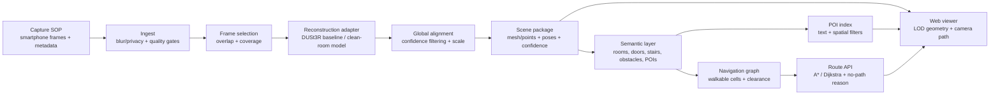

# NammaSpace technical report: a DUSt3R-centred spatial engine

## Design objective

The repository contains an implemented DUSt3R reconstruction core in `demo.py`. It accepts multiple images, performs pairwise inference and global alignment, filters confidence, and exports a colored GLB scene. The implementation produced usable reconstructions and the example outputs included here, but its geometry quality was not yet as reliable as the NammaSpace navigation target required. This report therefore treats the result as a completed research implementation with a clear, measured gap to production-quality spatial understanding.

The system should turn a short, repeatable smartphone capture into a navigable indoor digital twin. The engineering goal is not merely a dense point cloud. It is a stable scene package that can be rendered in a browser, queried for POIs, and converted into a walkable graph for collision-aware routing.

The recommended design uses DUSt3R only as a reconstruction adapter. DUSt3R formulates pairwise reconstruction as pointmap regression and can operate without prior camera calibration or viewpoint poses. For more than two images, its global alignment stage expresses pairwise pointmaps in a common reference frame. The output can also recover depth, pixel matches, and relative/absolute camera information. [1] [2]

## System architecture



The same diagram is available as [`architecture/system.mmd`](../architecture/system.mmd).

## Capture SOP

Use a slow walking pass at chest height. Keep consecutive views overlapping and turn gradually at corners. Capture each room entrance from both sides, include floors and ceilings when safe, and record a route log with approximate start/end points. Avoid rapid panning, reflective-only views, people’s faces, screens, and sensitive documents. Keep a second pass for difficult areas such as glass, thin furniture, repetitive corridors, and stairs.

The SOP should produce a manifest with a session identifier, image paths, timestamps, capture device, approximate route order, operator, consent/retention status, and a scene boundary. Do not use hidden metadata as a substitute for geometric verification.

## Reconstruction pipeline

### 1. Ingest and quality gates

Decode frames, normalize orientation, remove duplicates, and score blur, exposure, motion, and overlap. Keep original files in a restricted staging area. Produce a derivative set for inference and a hash manifest for reproducibility.

### 2. Pairing and inference

For a baseline experiment, use the official DUSt3R inference interface with a fixed checkpoint and record the exact upstream commit, checkpoint hash, image resolution, device, and inference parameters. DUSt3R’s upstream documentation notes that its demo can skip global alignment for one or two images and exposes a confidence threshold for filtering low-confidence areas. [3]

The production adapter should hide the model behind a narrow interface:

```text
reconstruct(images, options) -> ReconstructionResult

ReconstructionResult:
  points: float32[N, 3]
  colors: uint8[N, 3]
  confidence: float32[N]
  cameras: Camera[]
  pair_matches: Match[]
  scale_status: {relative, metric, calibrated}
  provenance: ProvenanceRecord
```

### 3. Alignment and scene coordinates

Align pairwise outputs into a common frame, reject low-confidence points, remove isolated outliers, and estimate a canonical up direction from the capture SOP or scene geometry. DUSt3R’s output is not automatically a metrically surveyed BIM model. Treat scale as relative unless a measured reference, known camera parameter, or later calibration step establishes metric scale.

### 4. Geometry products

Create a browser-friendly representation rather than sending a raw dense point cloud. Keep a high-resolution research artifact, then derive a decimated mesh or splat/point representation, normal maps if useful, collision geometry, and level-of-detail tiles. Every derived artifact should retain the source scene hash and processing version.

### 5. Semantic and navigation layer

Represent walkability as a 2D or 2.5D occupancy grid with a configurable agent radius. Mark walls, furniture, closed doors, voids, stairs, and uncertain regions as blocked or restricted. Convert walkable cells into a graph and use A* with an admissible distance heuristic. Return a route polyline plus a human-readable failure reason when the graph is disconnected.

POIs should be stored as stable IDs with a label, aliases, category, 3D anchor, nearest walkable node, confidence, and source annotation. Use a simple lexical index first; add embeddings only after measuring whether they improve recall on the target vocabulary.

## Browser and API contract

The viewer should load a scene manifest first, then request geometry tiles and annotations. Keep the first render fast by showing a low-detail scene and progressively refining it. Required endpoints are:

```text
GET  /scenes/{scene_id}
GET  /scenes/{scene_id}/tiles/{tile_id}
GET  /scenes/{scene_id}/pois?q=...
POST /scenes/{scene_id}/routes
```

The route request should accept start and goal as POI IDs or 3D coordinates, a clearance profile, and an accessibility preference. The response should contain a route, estimated length, warnings, and the graph/version hashes used to compute it.

## Evaluation plan

Evaluate the whole system against the competition dimensions: capture/SOP reliability, reconstruction and visual quality, web viewer/UX, spatial search and path calculation, and pitch/technical Q&A. [1] Add measurable internal gates: capture success rate, completeness of rooms and corridors, drift at loop closures, percentage of points above confidence threshold, first-render latency, POI search recall, route success rate, collision violations, and no-path explanation quality.

A small annotated pilot should be enough to catch architecture failures. Do not overfit to a single room. Include a corridor loop, a cluttered room, a reflective surface, a doorway, and at least one occluded route.

## Main risks and mitigations

**Scale and drift:** retain relative-scale language, use measured anchors when available, and test loop closure. **Reflective and texture-poor surfaces:** capture oblique views, use confidence masks, and mark uncertainty rather than hallucinating geometry. **Large scenes:** control pair count, use keyframes, process in chunks, then align chunks with explicit seams. **Navigation safety:** use conservative collision dilation and treat uncertain geometry as blocked. **License ambiguity:** isolate DUSt3R behind an adapter, maintain a provenance register, and do not ship non-commercial artifacts into an unreviewed commercial context.

## References

[1]: https://techfest.org/competitions/nammaspace "Namma Space — Techfest, IIT Bombay"
[2]: https://arxiv.org/abs/2312.14132 "DUSt3R: Geometric 3D Vision Made Easy — arXiv abstract"
[3]: https://github.com/naver/dust3r "naver/dust3r — official implementation and README"
