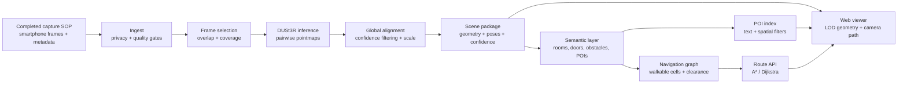

# NammaSpace technical report: implementing DUSt3R for indoor digital twins

## The question this project is trying to answer

Can a person walk through an indoor space with an ordinary smartphone, capture enough overlapping views, and receive a 3D scene that another person can explore, search, and navigate?

That is the real NammaSpace problem. It is not simply “make a point cloud.” A useful result needs a stable scene coordinate system, visible geometry, meaningful points of interest, and a route graph that does not send a user through walls, furniture, or uncertain geometry.

The repository implements DUSt3R as the reconstruction core and exports a colored GLB scene through [`demo.py`](../demo.py). The implementation worked well enough to prove the capture-to-3D pipeline and produce the example outputs included in this repository. It was not yet as reliable or complete as the final NammaSpace target required. The result is therefore best understood as a completed research implementation with a clear engineering gap, not as a claim that the problem is solved.

## Why DUSt3R fits the capture problem

Classical multi-view stereo usually expects camera calibration and camera poses before it can triangulate corresponding pixels. That is reasonable for a controlled survey, but it creates friction for a normal smartphone walkthrough. People do not usually record exact intrinsics, synchronized shutters, or carefully planned camera trajectories.

DUSt3R takes a different approach. It treats pairwise reconstruction as a regression of pointmaps. Instead of requiring calibrated and posed cameras as the first input, it predicts dense 3D structure for image pairs and then aligns those predictions when more images are available. The same formulation can provide depth, pixel correspondences, and camera information. [2]

That is a good match for NammaSpace because the capture SOP can focus on one thing humans are good at: walking slowly and collecting overlapping views. The model handles much of the geometric initialization that would otherwise be a separate calibration and structure-from-motion burden.

The trade-off is equally important. Removing calibration requirements does not remove geometry uncertainty. It moves more responsibility into learned prediction, global alignment, confidence filtering, and post-processing. A convenient capture process is valuable only if the resulting scene is honest about what it knows.

## What was implemented

The implementation in `demo.py` follows the official DUSt3R inference pattern:

1. Accept multiple images from one indoor scene.
2. Load the images at a documented inference resolution.
3. Create symmetric image pairs over the collection.
4. Run DUSt3R pairwise inference.
5. Use the two-image viewer mode for a pair, or global point-cloud optimization for a larger collection.
6. Align the predicted pointmaps into a common scene frame.
7. Remove low-confidence points using a configurable confidence percentile.
8. Export the surviving colored points as a GLB file for inspection.

The script exposes the important experiment variables rather than hiding them: model name or local weights, device, image size, number of alignment iterations, maximum image count, and output directory. The upstream repository documents the same major building blocks: model loading, image pairing, inference, global alignment, confidence filtering, and checkpoint handling. [3]

The implementation outcome was useful but limited. On the example capture, DUSt3R produced a recognizable scene with camera geometry and enough structure to demonstrate the idea. The result still showed the kinds of defects that matter for navigation: stretched surfaces, incomplete boundaries, uncertain floors and ceilings, and geometry that looked plausible from one viewpoint but was not dependable as a collision surface. The visual output was therefore a successful research milestone, not a finished spatial map.

## End-to-end architecture



The source diagram is available at [`architecture/system.mmd`](../architecture/system.mmd).

### Capture and ingest

The completed SOP should produce gradual motion and overlapping views. Corners, doors, corridor junctions, floors, ceilings, reflective surfaces, and texture-poor walls deserve deliberate coverage because they are exactly where a reconstruction can become ambiguous.

Each session should have a manifest containing a session identifier, image paths, timestamps, device information, route order, operator, consent or retention status, and scene boundary. Ingest then normalizes orientation, removes duplicates, scores blur and exposure, checks motion, and creates a derivative image set for inference. Original data should remain in restricted staging.

### Pairwise reconstruction

For each selected image pair, DUSt3R predicts a pointmap: a 3D point associated with image evidence. This is more flexible than forcing every early prediction through a fully specified pinhole-camera model. The output is useful for dense geometry, but it should still be treated as a prediction with confidence rather than a measured survey.

For two images, the implementation can inspect the pair directly. For larger collections, pairwise results must be brought into a common frame. The number and quality of pairs matter. Complete pairing can become expensive as the image count grows, while too few or poorly chosen pairs can leave parts of the scene weakly connected.

### Global alignment

The multi-image stage estimates a common scene arrangement from the pairwise outputs. In practice, this is where local predictions become a candidate indoor scene. Alignment should be logged with its iteration count, schedule, learning rate, input list, checkpoint, and confidence policy.

The resulting scene is not automatically metric. Unless there is a measured reference, known camera information, or a later calibration step, it should be labelled relative scale. A scene that looks geometrically convincing can still be the wrong size for a real route or accessibility calculation.

### Scene package

The research output should contain more than a GLB:

```text
ScenePackage:
  geometry: points or mesh with colors
  cameras: estimated camera poses and intrinsics when available
  confidence: per-point or per-region confidence
  scale_status: relative | metric | calibrated
  bounds: scene extent and coordinate convention
  provenance: source hashes, model hash, parameters, and license track
  semantics: rooms, doors, obstacles, stairs, and POIs
  navigation: walkable map, graph version, and clearance profile
```

The GLB is the convenient visual artifact. The scene package is the reproducible engineering artifact.

## Benefits and costs of DUSt3R

| Dimension | Why DUSt3R helps | What the team must still solve |
|---|---|---|
| Capture | Works with uncalibrated, unposed image collections, reducing setup burden. [2] | The capture still needs overlap, gradual motion, and coverage of difficult surfaces. |
| Reconstruction | Produces dense pointmap predictions and can unify depth, matching, and camera recovery. [2] | Learned predictions can be locally plausible but globally wrong. |
| Multi-view use | Global alignment provides a path from pairwise outputs to a common scene. [2] | Alignment can drift, stretch, or leave disconnected and uncertain regions. |
| Development speed | A strong research implementation and pretrained checkpoints make experiments practical. [3] | Checkpoint, dataset, and base-model licenses must be audited separately. |
| Browser output | Point and color data can be exported into a portable 3D artifact. | Raw dense geometry is too heavy and too noisy for a polished viewer. |
| Navigation | Confidence can guide conservative filtering and blocked-region decisions. | DUSt3R does not understand walkability, room labels, doors, or user intent by itself. |
| Scale | Useful relative geometry can be obtained without a full survey. | Metric scale must be established before claiming physical route lengths. |
| Generality | The same representation supports several geometric tasks. [2] | Performance still depends on scene appearance, image overlap, and resolution. |

The short version is that DUSt3R removes a painful input requirement, not the need for engineering judgement.

## DUSt3R compared with a classical calibrated pipeline

| Approach | Best feature | Main weakness for this project | Appropriate NammaSpace role |
|---|---|---|---|
| Calibrated SfM/MVS | Mature geometric assumptions and strong control when cameras and poses are reliable | Requires more careful capture, calibration, feature matching, and failure handling | A valuable validation or fallback path when metric accuracy matters |
| DUSt3R | Fast path from ordinary images to dense geometry without requiring poses up front | Learned geometry and global alignment can be uncertain on difficult indoor scenes | Primary research implementation and rapid reconstruction baseline |
| Hybrid system | Combines learned initialization with geometric refinement and measured anchors | More components, more tuning, and more provenance work | Likely long-term direction for reliable navigation |

DUSt3R is the right first implementation for the project because it lets the team test the complete experience early. It should not automatically be the final answer for metric navigation. A hybrid pipeline can use DUSt3R to initialize structure, then use loop closure, measured scale, plane constraints, or a classical refinement stage where the application demands stronger guarantees.

## What worked in the implementation

The implementation established several important facts:

- A small multi-image indoor capture can be processed through one coherent DUSt3R pipeline.
- The model can produce a scene artifact that is easy to inspect in a normal 3D viewer.
- The confidence threshold is a practical control for reducing visibly weak regions.
- The adapter boundary is feasible: the rest of NammaSpace can consume a scene package without depending on every internal model detail.
- The approach is fast enough for research iteration compared with building a complete calibrated pipeline before seeing any result.

These are meaningful successes. They turn the project from a model-selection discussion into an empirical system with observable failure modes.

## What was not good enough yet

The implementation did not meet the quality bar required for trustworthy indoor navigation. The main issues are not cosmetic.

### Geometry quality

Some surfaces were stretched or incomplete. This matters because a visually acceptable render can still produce a wrong wall boundary or an unreliable floor plane. The viewer may tolerate that. A collision graph should not.

### Global consistency

A scene can look good locally while drifting across a corridor or around a loop. Without loop-closure checks or measured anchors, the system cannot assume that two parts of the same building share a reliable scale and frame.

### Difficult materials

Glass, reflective surfaces, blank walls, thin objects, repetitive furniture, and low-light areas provide weak or ambiguous visual evidence. These regions need extra views, confidence masks, or explicit “unknown” labels.

### Semantic absence

DUSt3R reconstructs geometry; it does not automatically know that a particular point is a door, reception desk, staircase, or obstacle. POI tagging and walkability remain separate system layers.

### Compute and scene size

Dense pairwise reasoning can become expensive as the number of images grows. A practical system needs keyframe selection, chunking, controlled pairing, and a way to merge local scene products without hiding seams.

### License boundaries

The official DUSt3R repository places its code under CC BY-NC-SA 4.0 and notes that checkpoints also depend on the licenses of public training datasets and base checkpoints. [3] The Creative Commons terms allow reproduction and adaptations for NonCommercial purposes subject to attribution and ShareAlike conditions. [4] This is compatible with a carefully reviewed research track, not an automatic permission for commercial deployment.

## Engineering recommendations after the first implementation

1. **Improve the capture before changing the model.** More consistent overlap and coverage can yield a larger practical improvement than immediately changing checkpoints.
2. **Select keyframes instead of pairing every frame.** Keep views that add coverage, viewpoint change, or loop-closure evidence.
3. **Measure confidence spatially.** Convert point confidence into regions so the viewer and navigation graph can treat weak areas conservatively.
4. **Add scale anchors.** A measured doorway, known floor marker, or other controlled reference is more useful than quietly assuming metric scale.
5. **Test loop closure explicitly.** Walk a route that returns near its start and measure drift before building pathfinding claims.
6. **Keep uncertain geometry blocked.** A false obstacle is inconvenient; a missing wall can make a route unsafe.
7. **Separate visual and collision geometry.** The viewer can use a detailed representation while the planner uses a simplified, conservative surface.
8. **Create the scene package before the final viewer.** Stable files and schemas make it possible to compare models, checkpoints, and post-processing choices fairly.
9. **Use a hybrid refinement path if navigation remains unstable.** DUSt3R can remain the fast initializer while geometric or measured constraints improve the final map.
10. **Record failure cases, not only successful screenshots.** A research report becomes more credible when it explains where the system breaks and what the next experiment is meant to fix.

## Evaluation plan

The evaluation should measure the complete experience:

| Area | Example metric | Why it matters |
|---|---|---|
| Capture | Successful reconstructions per SOP run | Tests whether another operator can reproduce the result |
| Geometry | Completeness, drift, confidence coverage, scale consistency | Separates a compelling view from a usable map |
| Viewer | First-render latency, progressive-load time, interaction smoothness | Determines whether the result feels usable |
| POIs | Search recall, anchor error, label correctness | Measures whether the scene can answer human questions |
| Navigation | Route success, collision violations, no-path explanations | Tests the actual spatial-engine objective |
| Reproducibility | Clean-run success and provenance completeness | Makes the result defensible and repeatable |

The pilot set should include a corridor loop, a cluttered room, a doorway, a reflective or texture-poor surface, and an occluded route. A single easy room is useful for a first demo but insufficient evidence for an indoor navigation system.

## Final assessment

DUSt3R was the right research implementation for this stage because it made the first end-to-end experiment possible with ordinary image collections and without a fully calibrated capture rig. It produced a usable reconstruction and exposed the real next problems: confidence, scale, drift, difficult materials, scene size, semantics, and navigation safety.

Its limitation is also clear. A DUSt3R point cloud is not automatically a reliable digital twin. The best NammaSpace system will use DUSt3R’s flexibility as a starting point, then add conservative geometry processing, explicit uncertainty, semantics, measured scale where available, and a navigation layer that refuses to pretend when the evidence is weak.

## References

[1]: https://techfest.org/competitions/nammaspace "Namma Space — Techfest, IIT Bombay"
[2]: https://arxiv.org/abs/2312.14132 "DUSt3R: Geometric 3D Vision Made Easy — arXiv abstract"
[3]: https://github.com/naver/dust3r "naver/dust3r — official implementation and README"
[4]: https://creativecommons.org/licenses/by-nc-sa/4.0/legalcode.en "Creative Commons Attribution-NonCommercial-ShareAlike 4.0 International — legal code"
